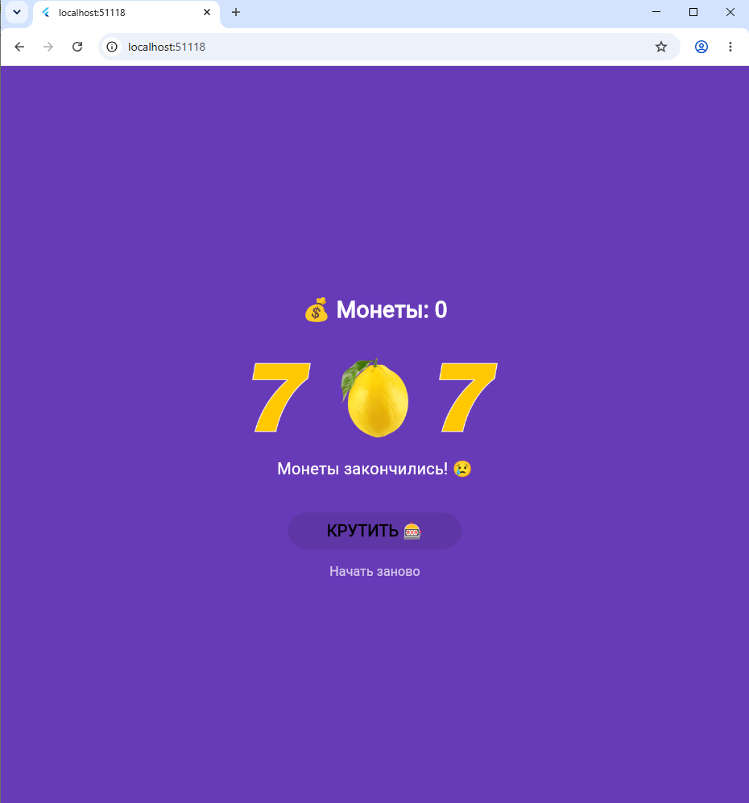

# Лабораторная работа №9. Flutter: StatefulWidget и управление состоянием

* **Выполнили:** Шкурский Максим и Буничева Алёна
* **Группа:** ИСП-242
* **Дата сдачи:** 13.11.2026

## О чем проект:
Написали игровой автомат на Flutter. В игре есть счетчик монет, три крутящихся барабана и кнопка сброса. Самое крутое это реалистичная анимация: слоты запускаются одновременно, а останавливаются по очереди с постепенным замедлением, как в настоящих автоматах.

## Что мы изучили:
1. На практике разобрались, в чем разница между `StatelessWidget` и `StatefulWidget`.
2. Научились работать с продвинутой асинхронностью. Через `Future.wait` запустили крутилку сразу на всех трех барабанах, а с помощью `Future.delayed` настроили фазы скорости.
3. Поняли, как защитить приложение от вылетов через проверку `if (!mounted)`. Это нужно, чтобы код не пытался обновить экран, если пользователь закрыл игру прямо во время вращения.
4. Освоили анимированные виджеты: применили `AnimatedOpacity`, чтобы барабаны плавно приглушались во время прокрутки, и `AnimatedSwitcher` для красивого появления надписи «ДЖЕКПОТ!».

## Как запустить проект:
1. `git clone https://github.com/youkani/Flutter_Lab9.git`
2. `cd Flutter_Lab9`
3. `code .`
4. `flutter pub get`
5. `flutter run -d chrome`
